# rustmark 架构现状评估（改造后）

- **评估基线**：`e09ad2b`（T11 FrameScheduler 落地后）
- **评估日期**：2026-10-20
- **方法**：静态扫描 + 人工核实 + **对 `check-arch` 判定逻辑的复刻验证**（非推断）
- **代码规模**：`src/` 302 个 `.rs` / 33 845 行；`tests/` 109 个文件 / 1 460 个 `#[test]`；
  `src/` 内联 407 个 `#[test]`

---

## 零、结论先行

**核心分层是健康的，这是本轮改造最重要的成果**：

| 判据 | 实测 | 判定 |
|---|---|---|
| `domain` → `infrastructure` 代码引用 | **0** | ✓ |
| `application` → `infrastructure` 引用 | **0** | ✓ |
| `domain` → `application` 代码引用 | **0**（仅 1 处 doc 注释） | ✓ |
| `application` trait 是否反向引用 domain 实现 | 否（`DocumentContentProvider` 签名只含 `DocumentId`/`String`/`FilePath`/`u64`） | ✓ |
| 基础设施的 trait 实现位置 | 全部在 `infrastructure` 侧（`fs_document_repository.rs:268` 等 9 处） | ✓ |
| `presentation` → `application` → `domain` 单向 | 是 | ✓ |
| `presentation/rich/` 是否依赖 `egui` / `theme` / `state` | **零命中** | ✓（ADR-007 边界有编译期保障） |
| 全仓 `TODO` / `FIXME` / `HACK` / `XXX` | **0** | ✓ |
| 域层 `clippy::todo` 等 lint 升级 | `src/domain.rs:14-25` `#![deny]` | ✓ |

**但「约束的执行者」本身有漏洞**：`check-arch` 是全部架构规则的唯一执行者，
而它只识别行首 `use ` 语句，已验证存在 4 类可静默绕过的形态（§2.1）。
同时 `presentation ↔ app` 之间存在**未被任何规则覆盖的双向环**（§2.2）。

本轮改造（T2/T3/T4/T6/T8/T9/T11）新增了 4 个抽象层（`widgets` / `rich` / `icons` /
`FrameScheduler`），**但没有为「表现层内部的依赖方向」建立机械规则**——目前
`views` 可以随意写 `state` 的字段，反向则没有守卫。这是遗留的最大结构性缺口。

---

## 一、模块职责与依赖关系

### 1.1 分层规模

| 层 | 文件 | 行数 | 占比 | 职责现状 |
|---|---:|---:|---:|---|
| `presentation` | 123 | 31 534 | **56%** | views 48 / state 24 / rich 25 / theme 9 / shortcuts 8 / widgets 2 / icons 1 |
| `infrastructure` | 47 | 10 221 | 18% | 持久化 / 导出 / 解析 / 高亮 / 拼写 / 字体 / PDF |
| `domain` | 46 | 7 282 | 13% | 5 个限界上下文，零 IO 零 UI |
| `application` | 43 | 6 201 | 11% | 用例编排 + DTO |
| `app` | 20 | 6 146 | 11% | 组合根 + 帧循环 + 胶合 |
| `shared` | 14 | 1 890 | 3% | 值对象 / trait 契约 / 工具 |

**`presentation` 占 56%** 是最显著的形态特征。ADR-007 / ADR-008 已把 `rich`
（5 917 行）与 `widgets`（402 行）从 `views` 中剥离，但 `views` 本身仍有 13 145 行。

**分层依赖总览图**（红 = 违反单向依赖或契约越界；绿 = 已验证合规）：



> 源文件：[`docs/arc/architecture-layers.svg`](./arc/architecture-layers.svg)（SVG）。
> 图中的违规边与本报告 §2 的问题编号一一对应：`shared → std::process` = P0-2，
> `presentation ↔ app` 双向环 = P1-1。

### 1.2 各层内部边界

- **`views/` vs `state/`** — 边界清晰，无交叉污染。✓
- **`rich/` vs `views/`** — 边界清晰**且有编译期保障**（`grep "use crate::presentation" src/presentation/rich/` 零命中）。✓
- **`presentation/theme/mapper/highlight_cache.rs` vs `application/markdown/service/highlight_cache.rs`** —
  **同名不同物**：前者是 egui `Galley` 的线程局部两层缓存，后者是 syntect span 的 LRU 缓存。⚠ 命名冲突。

### 1.3 组合根的胶合密度

`EditorApp`：**42 个字段 / 183 个非测试方法 / 14 个 impl 块**；`src/app/frame/` 16 文件共 5 325 行。

`app/frame/` 子模块职责（据文件头 doc）：

| 子模块 | 行数 | 职责 | 边界问题 |
|---|---:|---|---|
| `actions.rs` | 452 | T6 动作路由表（`action_route` 穷举） | 兼做 UI 状态初始化（`:25-29`、`:69`） |
| `editor.rs` | 549 | 行列换算 / 编辑同步 / 格式变换 | 格式二次分派（`:396`）与 `actions.rs` 分列两处 |
| `files.rs` | 514 | 保存 / 新建 / 状态栏 / 自动保存 | 通用状态栏方法、编辑器操作错位在此 |
| `workspace.rs` | 520 | 扫描 / 条目 / 打开 / 搜索分组 | 反向依赖 `files.rs`；`group_search_hits` 被 `outline.rs` 导入 |
| `capture.rs` | 476 | 图片导出 / 截图回传 | `save_document_to` 与 `files.rs` 路径处理逐字重复 |
| `settings.rs` | 358 | 设置对话框 | — |
| `tabs.rs` | 291 | 多标签 | — |
| `dialog.rs` | 273 | 原生对话框 | 状态栏提示逻辑重复写一遍 |
| `scheduler.rs` | 243 | T11 定时调度 | — |
| `find.rs` | 181 | 查找替换 | — |
| `outline.rs` | 146 | 大纲 / 拼写 | 导入 `workspace.rs` 的纯函数 |
| `recovery.rs` | 95 | 草稿恢复提示 | — |
| `editor/ime.rs` | 403 | IME 组合期 | — |

---

## 二、问题清单（按影响程度排序）

### P0-1 · `check-arch` 存在 4 类可静默绕过的形态 ⚠ 最高优先

**现象**　`tools/arch_check.rs:214` 只识别「行首（trim 后）以 `use ` 开头」的行：

```rust
let Some(rest) = line.strip_prefix("use ") else { continue; };
```

**已验证的绕过形态**（复刻判定逻辑实测，非推断）：

| 形态 | 实测结果 |
|---|---|
| `use egui::Context;` | 命中 ✓ |
| `pub use egui::Context;` | **绕过**（`strip_prefix("use ")` 匹配不到 `pub use`） |
| `use crate::{domain::document::Document};` | **绕过**（路径被整体截断为 `crate::{domain::…}`） |
| `fn f(d: crate::domain::…::Document) {}` | **绕过**（类型位置的全路径不被扫描） |
| `fn f() { use egui::Context; }`（单行） | **绕过**（多行写法可检出） |
| `impl Display for crate::domain::…::Document` | **绕过** |

**附加盲区**　`scan()` 只递归 `src/`（`src/bin/check-arch.rs:17`、`build.rs:27`），
**`tests/` 完全不在扫描范围**。

**当前是否已造成实际违规**　**否**。全库 `pub use` 均为同层 `self::` 重导出；
`presentation/` 内 `crate::domain::` 的 2 处命中全部在 doc 注释里。

**影响**　这是**全部架构规则的唯一执行者**。它的绕过形态 = 规则可被无声违反，
而分层违规的表现通常是「运行期诡异行为」而非编译错误。**守卫的守卫缺失**。

**建议**　把判定从「行首 `use `」改为「**行内任意位置的路径 token**」：
用正则提取 `crate::[a-z_]+(::[A-Za-z0-9_]+)+` 与裸 crate 名（`egui`/`eframe`/`rfd`…），
在**去掉注释与字符串字面量**后逐 token 比对。这样 `pub use`、组花括号、
全路径类型位置、全路径调用一次全覆盖。
另：`tests/` 纳入扫描范围（或至少扫描 `tests/` 的 `use` 形态）。

**预期收益**　把「架构约束」从「靠约定的文本扫描」升级为「真正拦得住的规则」。
成本：改 `tools/arch_check.rs` 判定逻辑 + 补一组变异用例（每种绕过形态一条
「注入后必须报错」的 fixture，用 `tests/arch_violation_fixture.rs` 现有模式）。

**风险**　规则变严后可能立刻报出既有违规（需先跑一次全量扫描看命中数）。
建议先以「只报告不失败」模式跑一遍，摸清存量再启用。

---

### P0-2 · `shared` 层内做进程调用，文档与实现自相矛盾

**现象**　`src/shared/system.rs:13` `use std::process::Command;`，
`:26-36` 直接 `Command::new("cmd"/"open"/"xdg-open").spawn()`。
文件头 `:1` 自称「共享内核，**零外部依赖**」，`:8-11` 自认
「`std::process` 不在其禁止清单，故在此落位」——**这是绕规则落位，不是遵守规则**。

**成因**　`PRESENTATION_FORBIDDEN`（`tools/arch_check.rs:47`）禁了
`crate::infrastructure`，而「打开外部链接」是表现层需要的能力 → 能力被挤进 `shared`。

**建议**　改成**端口 + 基础设施实现**（与 `shared::dialog::DialogPort` 同一手法）：
`shared::system::ExternalOpener` trait（`fn open(&self, target: &str) -> io::Result<()>`）
→ 实现落在 `infrastructure` → `app` 组合根注入给 `presentation`。
同时把 `std::process` 加进 `SHARED_FORBIDDEN`（或在 `shared` 的注释里明确「共享内核
允许的外部依赖」白名单）。

**预期收益**　`shared` 恢复「零 IO」语义，文档与实现一致；
「打开外部链接」从此可在无头环境用假实现测试（当前无法测——`spawn` 真进程）。

---

### P0-3 · 三处用户可见的功能缺口

| # | 位置 | 现象 |
|---|---|---|
| 1 | `src/app/frame/actions.rs:289` | `A::Revert \| A::InsertImage => ActionRoute::Unbound` —— **「撤销」与「插入图片」按下毫无反应**。已有断言（`:433-440`）锁死 Unbound 清单 |
| 2 | `src/app/frame/settings.rs:154` | 「设置页尚未提供写作目标输入框」—— 领域字段存在、状态栏进度条存在，但**无 UI 入口** |
| 3 | `src/app/frame/tabs.rs:33-35` | 「每文档独立的光标 / 选区尚未在 UI State 中建模」—— **切标签时光标跳回文档开头** |

**建议**　① 接线 `Revert`（撤销链路在领域侧已齐备，只差路由）；② 设置页补写作目标
输入（领域与 DTO 已就绪）；③ 切标签保留光标——需要 per-doc 光标状态，
属 UI State 建模变更，工作量最大，建议排最后。

**预期收益**　①② 各 1 处接线 + 少量 UI 即可闭环；③ 属体验修复，可独立评估。

---

### P1-1 · `presentation ↔ app` 双向环，且无任何规则覆盖

**现象**

- `presentation` → `app`：**32 处 `use crate::app::` 分布在 32 个文件**（几乎每个视图一个）
- `app` → `presentation`：`src/app/frame.rs:601` 调 `main_view::show(self, ui)`
- **状态所有权真空**：`presentation` 层直接写 app 层状态字段 **59 处**
  （`export_view.rs` 连续 7 处改 `app.export_ui.*`；`diff_view.rs:70/94/95`；
  `editor_view.rs:345-346/428`…），`app` 层自己也改 **43 处**——
  `app` 的 state 结构体有 **150 个 `pub` 字段**，穿透零成本。
- `check-arch` **完全不覆盖这个方向**：`layer_of()` 对 `app` 返回 `""`（不受任何禁令约束），
  `PRESENTATION_FORBIDDEN` 也不含 `crate::app`。

**建议**　分两步，不要一步到位：

1. **先定所有权**：对每个 UI state 结构体明确「谁拥有」。约定
   「**表现层只读 + 通过方法改**」或「**app 层拥有，视图通过命令改**」二选一。
   先做 `export_ui`（59 处里最密集的 7 处）与 `diff_ui`。
2. **再补规则**：`check-arch` 增加一条「`presentation` 不得直接写 `app.<state>.<field>`」
   的赋值形态检查（与本次 T11 新增的「预约唯一出口」同一手法：文本扫描 + 构建期拦截）。
   `presentation` → `app::EditorApp` 的**类型**依赖可保留（egui 的 `App::ui` 契约
   要求视图拿到 app），不必禁。

**预期收益**　状态变更点收敛到可枚举的位置，视图层不再能绕过 app 层直接改 UI 状态；
这是「新增一个 UI 状态字段要改几处」从 N 降到 1–2 的前提。

**风险**　59 处改写会触及大量视图；建议**按 state 结构体逐个推进**，每个结构体改完
立即补规则并跑门禁，不要一次铺开。

---

### P1-2 · 导出格式：双枚举 + 手写字符串 `match`（新增格式改 6 处，其中 1 处漏改是运行期错误）

**现象**

| # | 位置 | 内容 | 漏加后果 |
|---|---|---|---|
| 1 | `domain/export/value_objects.rs:10` | 领域 `ExportFormat` 枚举 | 编译失败 ✓ |
| 2 | `application/export/service.rs:224` | `parse_format()` **手写字符串 `match`** | **运行期报「未知导出格式」** ✗ |
| 3 | `presentation/state/export_ui_state/choices.rs:5` | `ExportFormatChoice` —— **与领域枚举几乎逐行同构的第二套枚举**（8 个方法语义一一对应） | 编译失败，但**两套枚举靠字符串对齐，无编译期保证** ✗ |
| 4 | `infrastructure/export/routing_exporter.rs:52` | 导出路由 `match` | 编译失败 ✓ |
| 5 | `infrastructure/export/pulldown_html_exporter.rs:292` | 内容导出器分支 | 编译失败 ✓ |
| 6 | `domain/export/aggregate.rs:109` | PDF 特判 | — |

**建议**　① `ExportFormatChoice` 改为对领域 `ExportFormat` 的**薄包装**
（保留 UI 需要的展示字段，如 `pdf_caveat`）；② `parse_format` 改为
`ExportFormat::from_str` 的**穷举实现**（漏加变编译错误）。

**预期收益**　新增导出格式从「改 6 处，其中 1 处漏改是运行期错误」降到
「改 3–4 处，全部编译期暴露」。这是**扩展性瓶颈里最值得修的一个**。

---

### P1-3 · 高亮 span 的应用有三份并行实现 + 两张样式表

**现象**

| # | 实现 | 位置 | 机制 | 能表达重叠 span？ |
|---|---|---|---|---|
| A | `build_line_job` | `presentation/theme/mapper/highlight_cache.rs:253-333` | 边界并集 + `find` 覆盖 | ✓（支持查找命中背景叠加） |
| B | `highlighted_code_job` | `presentation/views/preview_view/code.rs:98-143` | 顺序游标 | ✗ |
| C | `build_text_job` | `presentation/views/preview_view/inline.rs:319-` | 顺序游标 | ✗ |

样式表也是两份：`mapper.format()`（`mapper.rs:99`，15 种样式）vs
`inline.rs:19` 的 `span_format()`（另一张表，14 种样式）。
**公共项（heading/strong/emphasis/strikethrough/code/link/quote）各自实现——
改一处颜色另一处会漂。**

字符边界防护也分两套：`shared::geometry.rs:170` `floor_char_boundary`（mapper 用）
vs `:188` `clamp_to_char_boundaries`（code/inline 用）。

**建议**　① 把 A 的「边界并集 + 覆盖」抽成**表现层唯一的 span→`LayoutJob` 构造器**，
B/C 改为调用它（若某些 span 语义确实不同，抽出 `SpanPolicy` 参数而非复制实现）；
② 两张样式表合并为一张（`mapper` 已有更全的覆盖，inline 缺的样式补上）。

**预期收益**　预览区与编辑区的语法配色**永远一致**（当前改主题色会漂）；
消除两份重复测试。

---

### P1-4 · 主题双枚举 + 第三份手写映射

**现象**　`BuiltinTheme`（`presentation/theme/builtin/kind.rs:5`，3 变体）
vs 领域 `ThemeKind`（`domain/preferences/value_objects/theme.rs:11`，4 变体多 `Custom`），
靠字符串 `"dark"/"light"/"system"` 对齐；**`app/frame/actions.rs:20-24` 还有第三份手写 `match`**。
新增内置主题要改 4 处，其中 `application/preferences/service.rs:237` 的字符串映射是手写 `match`。

**建议**　让 `BuiltinTheme` 直接成为领域 `ThemeKind` 的表现层投影
（或反之），删掉第三份 `actions.rs` 映射（改用 `kind.as_str()`）。

**预期收益**　主题相关新增从 4 处降到 2 处，且不再有「字符串对不上」的静默失败。

---

### P1-5 · 快捷键：`persisted_key()` 是唯一「漏加不报错」的点

**现象**　新增一个 `UiAction` 要改 **5–8 处**（`registry/action.rs` 变体、
`impls.rs` 的 `ALL`/`persisted_key`/`label`/`group`/`keywords`/`default_combo`、
`app/frame/actions.rs` 的 `action_route`、可持久化时再加领域 `ActionId` 与
`default_bindings()`）。其中 `label`/`group`/`keywords`/`default_combo`/`action_route`
都是穷举 `match`（漏加**编译失败** ✓），**唯独 `persisted_key()`（`impls.rs:112`）
是 `_ => return None` 兜底** → 忘记加它，用户改键**静默失效**。

另：`default_bindings()`（`domain/.../shortcut_table.rs:150`）与
`UiAction::default_combo()`（`impls.rs:322`）是**两份并行的默认键位表**，
靠 `persisted_key` 字符串对齐，**无编译期检查**。

**建议**　① `persisted_key()` 改为穷举（返回 `Option` 仍有意义，但**漏加应是编译错误**
——改成返回 `&'static str`，不可持久化的用显式常量）；② 两份默认键位表合并为一份
（领域侧为准，表现层读取）。

**预期收益**　消除「改键静默失效」这一类无提示缺陷。

---

### P2-1 · `floor_char_boundary` 私有副本（1 行修复）

`src/application/workspace/service.rs:525` 有一份**私有副本**，
与 `src/shared/geometry.rs:170` 的公开版本功能相同（连注释理由都一样）。
**建议**　删掉私有副本，改用 `shared::geometry::floor_char_boundary`。
**预期收益**　消除一份重复实现 + 一份重复测试。**成本极低，应立即做。**

---

### P2-2 · 文件名提取 5 种写法，其中 2 处不处理反斜杠

`rsplit('/')` 5 处、`rsplit(['/','\\'])` 2 处、`FilePath::file_name` 1 处。
其中 **`src/app/frame/dialog.rs:166` 与 `:253` 的 `rsplit('/')` 不处理反斜杠**，
而 `files.rs:408` 与 `shared/text_format.rs:98` 处理了 → **Windows 原生路径下
对话框会显示整条路径**。**建议**　统一走 `FilePath::file_name`。
**预期收益**　消除一个平台相关的用户可见显示缺陷。

---

### P2-3 · 格式白名单有 2 处硬编码漏网

`shared/text_format.rs` 已是唯一出处，但：① `app/frame/workspace.rs:191,194`
另存为建议名硬编码 `.md`（不查白名单）；② `workspace.rs:279-280` 与
`files.rs:454` 的**注释里手写了白名单清单**（`md/markdown/mdown/mkd/txt/text/csv`），
与常量双份 → 加格式时注释会漂。

---

### P2-4 · `widgets` 层实际采用率低，且 065 反模式仍在生产代码

| 组件 | 生产调用点 | 位置 |
|---|---:|---|
| `clickable_row` | 4 | `sidebar_view/{files,lint,outline,search}.rs` |
| `elided_segment` | 2 | `sidebar_view/{lint,outline}.rs` |
| `put_elided` | 4 | `quick_open_view.rs:271`、`toolbar_view.rs:306/631`、`welcome_view/recent.rs:106` |

**10 处调用点覆盖 5 个文件，`presentation` 其余 ~118 个文件一处未用。**

更值得注意：**`sidebar_view/search.rs:176` 仍在用
`allocate_ui_with_layout(vec2(avail, 0.0), …)`** ——这正是
`presentation/widgets/text.rs:18` 明确点名的 065 反模式（0 高导致垂直错位），
而 `elided_segment` 的参数类型设计（高度取自 `Rect`）就是为了让这种写法「说不出口」。
`:182` 还用裸 `Label::truncate()`（不限宽、不左对齐）。

另有一类**未收口**的重复配方：「行矩形 + `Sense::click` + hover 底色
`rect_filled(CornerRadius::same(4))`」在 4 处**逐字重复**
（`quick_open_view.rs:226-229`、`command_palette_view.rs:223-226`、
`toolbar_view.rs:421-423`、`toolbar_view.rs:473-475`）——
它符合 ADR-008 的三条标准（≥2 处重复 / 写错不报错 / 直觉写法看起来合理），
说明**收口标准在执行时有缺口**。

**建议**　① 把 `search.rs:176-182` 改用 `elided_segment`（消除已知反模式）；
② 评估「可点行 + hover 底色」是否应成为第 4 个 widgets 组件（ADR-008 允许按
「第 3 次复发或 3 处以上重复」触发扩充，此处已 4 处）。

---

### P2-5 · 文档过期 8+ 处（直接削弱「一个事实一个家」的可信度）

| 位置 | 文档写的 | 实际 | 偏差 |
|---|---|---|---|
| `docs/README.md:53` | ADR-001 = egui + eframe **0.33.3** | `Cargo.toml:48,52` = **0.37.0** | 跨大版本 |
| `docs/README.md:64` | 问题记录 **001–027** | 实际到 **069** | **42 条** |
| `docs/README.md:47-58` | ADR 索引只列 001–006 | `docs/adr/` 实有 **009** 篇 | 缺 3 篇 |
| `docs/README.md:50` | `06-表现层与交互实现.md` = **76KB** | 633 行 ≈ 30KB 级 | 数字过期 |
| `docs/testing.md:37` | **1623 passed / 0 failed / 0 ignored** | **1862 passed / 3 ignored** | 差 239 条 + ignored 数错 |
| `docs/PROGRESS.md:53,79` | 同上 1623 passed | 同上 | 同上 |
| `docs/PROGRESS.md:175` | egui 0.33.3 | 0.37.0 | 同上 |
| `docs/11-预览区技术实现.md:369,371` | `src/presentation/views/math.rs`、`mermaid.rs` | 已在 `presentation/rich/{math,mermaid}/` | 路径过期（ADR-007 已迁） |
| `docs/05-基础设施实现.md:40,56,63,70,105` | 5 个测试文件名 | 实际文件名不同 | 5 处路径过期 |
| `tests/e2e/main.rs:5`、`tests/integration/large_file_test.rs:472` | `docs/e2e-cases.md` / `docs/large-file-report.md` | 在 `docs/archive/stage-reports/` 下 | 路径过期 |
| `docs/metrics.md:211` | exe 11 892 736 B = 11.34 MiB | 11 907 584 B = 11.35 MiB | 0.02 MiB（结论仍成立） |

**建议**　① 更新 `docs/README.md` 的 ADR 索引与问题记录编号区间；
② `docs/testing.md` / `PROGRESS.md` 的测试数改为**当日实测**并标注日期
（项目已有「全绿必须附当日实测命令+数字」纪律，此处只是没执行）；
③ 修 5+2 处路径过期。

---

### P2-6 · ADR 缺口 5 项

以下**已在代码中落地并被文档多处引用**的结构性决定无 ADR 记录：

| 决定 | 位置 | 现状 |
|---|---|---|
| `ActionRoute` 穷举动作表 + `Unbound` 显式声明 | `app/frame/actions.rs:189-289` | `docs/adr/` 全无 `ActionRoute` 字样 |
| `RevealIntent` 双意图分流（离散跳转 vs 查找） | `presentation/views/scroll_sync.rs` | 仅见于 `docs/v1.1-backlog.md:7` |
| `presentation::icons` 的「规格 = 数据」图标系统 | `presentation/icons.rs`（562 行） | 仅见于 `docs/06:154` |
| 草稿旁车文件 `<id>.draft.path` 协议 | 问题记录 069 | `grep 旁车 docs/` **零结果** |
| 字体外置（改变发行包形态） | `metrics.md:203` | 无 ADR |

**建议**　ADR-010 一次性补齐「动作路由与双意图」与「图标系统」两条；
旁车协议与字体外置可合并为「文件与资源布局约定」。

---

### P2-7 · `infrastructure/fonts.rs` 1111 行，测试依赖真实资产存在

生产代码 646 行中**约 400 行直接依赖文件系统与平台路径**
（`builtin_font_path` / `discover_font_sources` / `scan_project_fonts_dir` /
`system_mono_candidates` ×3 / `load_cjk_font` / `extend_with_math_fallback` …），
无头环境**无法构造**。真正可测的纯逻辑只有 3 个函数（约 60 行）。

现有 18 个测试**通过读真实字体文件 / 依赖 `assets/fonts/` 存在**（如
`real_cjk_font_provides_glyphs_for_chinese`、`builtin_editor_fonts_are_registered_and_selectable`）→
**在不含 `assets/fonts/` 的机器（CI 干净克隆）上会失败**。

**建议**　把「路径发现」与「字体装配」拆开：前者接受注入的根目录列表（可测），
后者接受 `Arc<dyn FontSource>`（可测）；真实文件系统只留一层薄适配。

---

### P3 · 低severity 记录

| # | 位置 | 问题 |
|---|---|---|
| 1 | `presentation/theme/mapper/highlight_cache.rs` vs `application/markdown/service/highlight_cache.rs` | 同名不同物，建议改名（`galley_cache` / `span_cache`） |
| 2 | `shared/text_format.rs` ↔ `shared/dialog.rs` | **shared 内部循环依赖**（`:36` ↔ `:26`）；且 5 个使用点**全在 app 层** → 应下沉到 `app` 或 `infrastructure` |
| 3 | `presentation/views/` 拆分阈值不一致 | `preview_view.rs` 835 行未拆（其子目录已 3 040 行）、`toolbar_view.rs` 695、`status_bar_view.rs` 514、`command_palette_view.rs` 429、`export_view.rs` 421 全未拆 —— 同一目录两套标准 |
| 4 | `tests/infrastructure/pulldown_parser_test.rs:251` | `thematic_break_is_parsed` 断言仅 `assert!(!blocks.is_empty())` —— **无区分力**（区分不了「解析出 hr」「当普通段落」「解析成空」三种实现） |
| 5 | `src/shared/lru.rs` / `shared/text.rs` | 各只被 2 层使用，属「勉强留在 shared」，可下沉或改名 |
| 6 | `src/domain/workspace/repository.rs:47` | doc 注释反向引用 `crate::app::frame::EditorApp::request_delete`（领域文档引用组合根） |
| 7 | `src/app/frame/files.rs:61` / `editor.rs:301` / `workspace.rs:134` | 三个「取当前文档路径/目录」方法并存，返回类型还各不相同（`String` / `Option<PathBuf>` / `Option<String>`） |
| 8 | `src/app/frame/workspace.rs:502` `group_search_hits` | 搜索结果分组的纯函数住在 `workspace.rs`，却被 `outline.rs:3` 反向导入 |
| 9 | `src/app/frame/files.rs:438` vs `workspace.rs:298` | 打开文档两条实现；`files.rs` 的 `open_path` 只是薄包装，而 `workspace.rs` 反向调用 `files.rs:400` 的 `can_open_as_text` —— **依赖方向与命名相反** |
| 10 | `src/app/frame/capture.rs:86-93` vs `files.rs:193-205` | `FilePath::new(path).map_err(...)` + `refresh_text()` 这一对逐字重复；且同一类错误两种映射（`AppError::Config` vs `AppError::domain`） |
| 11 | `FontId::monospace(...)` 硬编码 12 处 | 字号来源各不相同（`theme.metrics.preview_font_size` / 字面量 11.0/12.0/13.0） |

---

## 三、风险点

### 3.1 本次评估自身的方法风险

| 风险 | 说明 | 缓解 |
|---|---|---|
| **行号漂移** | 全部结论基于 `e09ad2b`；任何后续提交都会使行号失效 | 结论均附**文件路径 + 符号名**，可直接 grep 复核 |
| **静态分析 ≠ 运行时** | 未做运行时依赖分析（如 `cargo-udeps` / `cargo tree`）；「0 处违规」指**文本引用**，不排除通过 `impl Trait` 等间接方式 | `domain`/`application` 的 trait 签名已逐个人工核对 |
| **内联测试覆盖率推断** | 「47/302 文件有内联测试」只反映**文件级 `cfg(test)` 分布**，未计入 `tests/` 下 1 460 个跨文件集成测试 → **实际覆盖率显著高于该比例** | 基础设施层尤其如此（300 个测试在 `tests/infrastructure/`） |
| **子代理结论已复核** | 三份探查报告的关键结论（check-arch 4 类绕过、presentation→app 32 处、`floor_char_boundary` 双份、双枚举、065 反模式、文档过期 8+ 处）**均由我独立复刻判定逻辑或 grep 复核** | 报告中已标注「已核实」与「转述」 |

### 3.2 改造遗留的不一致

| # | 不一致 | 说明 |
|---|---|---|
| 1 | **ADR-008 的收口标准执行有缺口** | ADR-008 明确「只收满足三条标准的组件」，但「可点行 + hover 底色」已在 4 处逐字重复且符合全部三条标准 → 说明**标准存在但未系统性执行** |
| 2 | **本轮新增 4 个抽象层，但没有表现层内部的依赖规则** | `widgets` / `rich` / `icons` / `FrameScheduler` 各有边界，但 `views` ↔ `state` 之间**无机械守卫**——`presentation` 内部 31 534 行只靠约定 |
| 3 | **ADR-009 的 `begin`/`flush` 是软肋** | 两个必须成对的调用点，唯一的兜底是「真实帧 `repaint_delay`」测试；ADR-009 已在「后果」里如实登记 |
| 4 | **`check-arch` 的新规则（预约唯一出口）同样是文本扫描** | 但 `request_repaint_after` 是**函数调用**不是 `use` 路径，不受 P0-1 的绕过形态影响 ✓ |
| 5 | **T4 改了 `HighlightPace` 内部结构** | `(u64, Timestamp)` → `PaceEntry{revision, at, pending}`；`snapshot()` 签名保持不变，外部无感 ✓（已核实 `tests/application/markdown_service_test.rs` 未受影响） |
| 6 | **T9 的 `views.rs` re-export 保路径** | `views::math` / `views::mermaid` 仍是旧路径的别名 → 文档里 `docs/11-预览区技术实现.md:369,371` 仍写旧路径**反而没过期**（新路径 `rich/` 才是新的）—— 文档该写新路径 |

---

## 四、建议的推进顺序

> 每一步都应留下**可执行判据**（测试 / 机械规则），不留「靠自觉」。

### 第 1 批 · 低风险高收益（建议立即做，1–2 天）

| # | 事项 | 判据 | 预期收益 |
|---|---|---|---|
| 1 | 删 `application/workspace/service.rs:525` 的 `floor_char_boundary` 副本 | 改用 `shared::geometry` 版本，原测试迁移 | 消除重复实现与重复测试 |
| 2 | 统一文件名提取到 `FilePath::file_name` | 新增一条 Windows 反斜杠路径的用例 | 修掉「对话框显示整条路径」 |
| 3 | 修 `docs/README.md` 的 ADR 索引与问题记录编号；更新 `docs/testing.md` / `PROGRESS.md` 的测试数 | grep 校验 | 恢复文档索引可信度 |
| 4 | `sidebar_view/search.rs:176-182` 改用 `elided_segment` | 现有真帧测试 + 变异探针 | 消除已知 065 反模式 |

### 第 2 批 · 扩展性瓶颈（1 周）

| # | 事项 | 判据 | 预期收益 |
|---|---|---|---|
| 5 | 导出格式双枚举收敛 + `parse_format` 改穷举 | 新增一种格式的「只改 1 处」用例 | 新增导出格式 6 处 → 3 处，漏改从运行期变编译期 |
| 6 | `persisted_key()` 改穷举 + 合并两份默认键位表 | 新增可持久化动作的「漏加即编译失败」用例 | 消除「改键静默失效」 |
| 7 | 主题双枚举收敛 + 删 `actions.rs` 第三份映射 | 新增内置主题的「只改 N 处」用例 | 主题新增 4 处 → 2 处 |
| 8 | span→`LayoutJob` 构造器统一（3 份 → 1 份）+ 样式表合并 | 同一段 Markdown 在编辑区与预览区配色逐 span 一致的对拍用例 | 消除改色会漂 |

### 第 3 批 · 守卫加固（与第 2 批并行，需先摸存量）

| # | 事项 | 判据 | 预期收益 |
|---|---|---|---|
| 9 | `check-arch` 判定逻辑改为 token 级匹配（含 `pub use` / 组花括号 / 全路径 / impl-for）；`tests/` 纳入扫描 | 每种绕过形态一条「注入后必须报错」的 fixture | 架构规则从「靠约定」变「拦得住」 |
| 10 | `shared/system.rs` 改端口 + 基础设施实现 | 假实现可在无头环境测「打开外部链接」 | shared 恢复零 IO 语义 |

**建议 9 的执行方式**：先以「只报告不失败」跑全量，摸清存量命中数，再决定是否启用。
否则规则一收紧就可能阻塞构建。

### 第 4 批 · 结构改造（2–3 周，需用户决策）

| # | 事项 | 决策点 | 预期收益 |
|---|---|---|---|
| 11 | `presentation → app` 的状态所有权收敛 | 逐个 state 结构体推进（先 `export_ui`、`diff_ui`） | 状态变更点可枚举 |
| 12 | 三处用户可见功能缺口（`Revert` / 写作目标 / 切标签光标） | 优先级由产品定 | 直接的用户可感知修复 |
| 13 | `fonts.rs` 拆分（路径发现 / 装配分离） | 是否接受新增 trait | 测试可在无资产环境跑，CI 可移植 |
| 14 | `presentation/views/` 拆分阈值统一 | 是否值得 | 大文件可维护性 |
| 15 | 补 ADR-010（动作路由 + 图标系统 + 资源布局） | — | 结构性决定有据可查 |

### 第 5 批 · 收尾

| # | 事项 |
|---|---|
| 16 | `presentation` 内部依赖规则（views ↔ state）是否需要机械守卫，取决于第 4 批第 11 项的进展 |
| 17 | `shared/text_format.rs` 下沉；`shared/lru.rs` / `shared/text.rs` 归位 |
| 18 | 补 ADR（草稿旁车协议、字体外置） |

---

## 五、与本轮改造（T2/T3/T4/T6/T8/T9/T11）的关系

| 任务 | 遗留问题 |
|---|---|
| T2 字体外置 | `fonts.rs` 仍 1111 行、测试依赖真实资产（§P2-7）；发行包形态变更**无 ADR** |
| T3 统计 O(1) 防线 | 「排版/滚动同步守卫」与「调试面板归因」两半**仍未做** |
| T4 增量高亮 | `HighlightPace` 增 `pending` 后**未同步 ADR**（ADR-009 提了但未单列） |
| T6 路由表 | 路由表本身完整（穷举 + 3 守卫测试 ✓），但 `Revert` / `InsertImage` 仍是 `Unbound`（§P0-3） |
| T8 widgets | 10 处调用点 / 5 文件；065 反模式仍在 `search.rs:176`；「可点行 + hover 底色」4 处未收口（§P2-4） |
| T9 rich 下沉 | `docs/11-预览区技术实现.md:369,371` 仍写旧路径（§P2-5） |
| T11 FrameScheduler | `begin`/`flush` 成对契约是软肋（已登记在 ADR-009「后果」） |

---

*本评估未修改任何代码。所有数据由 `grep`/`find`/`wc` 实测得出；
`check-arch` 的绕过形态由复刻其判定逻辑逐条验证。*
