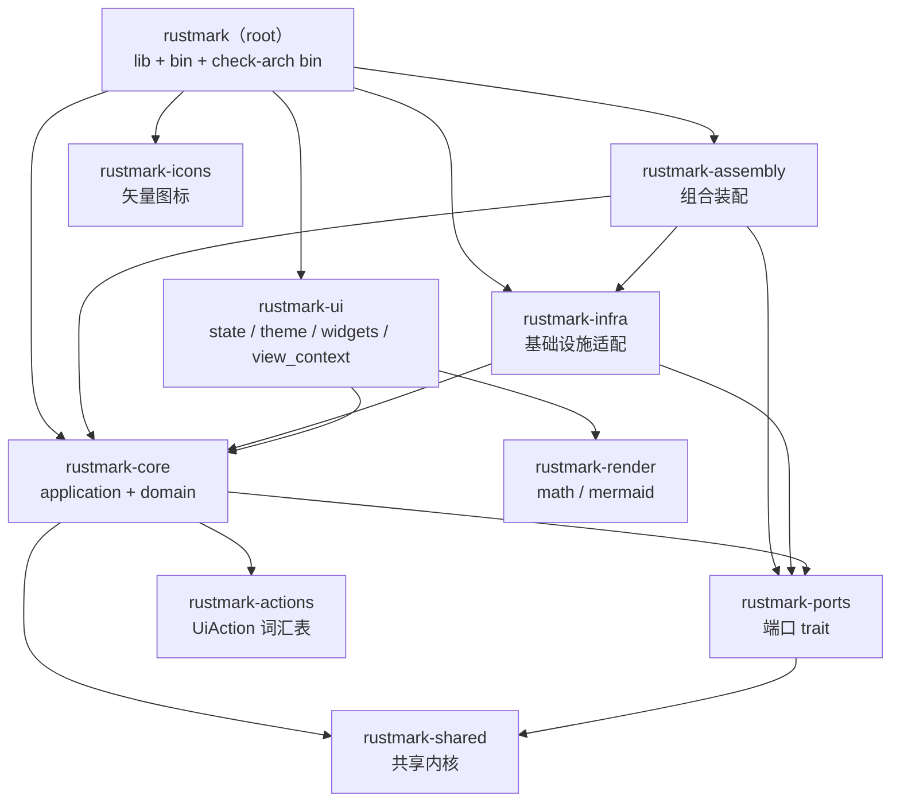
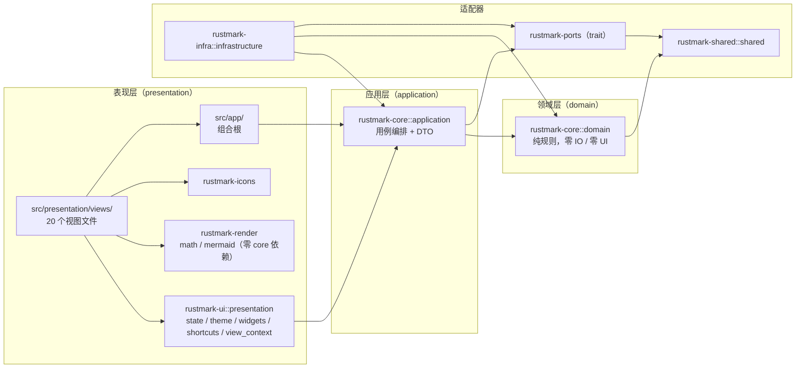
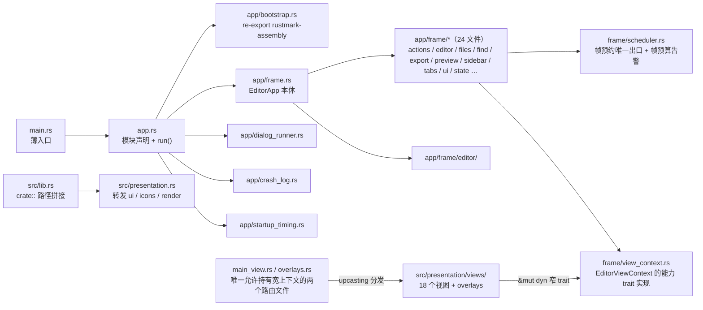
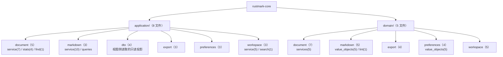
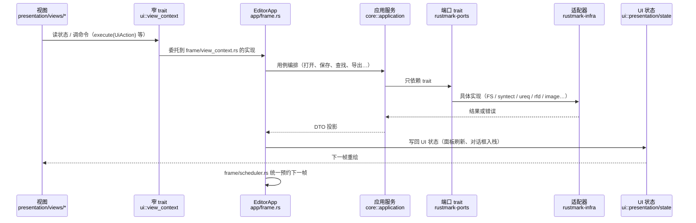
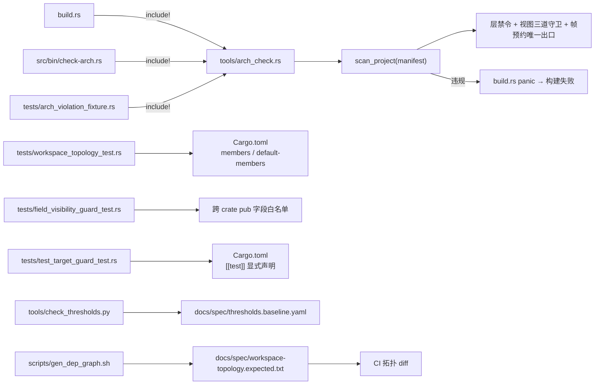

# 项目关联图（源码实测 · 2026-10-30）

> **范围**：全仓 10 个 crate / 511 个 `.rs`（生产源码 371 + `tests/` 138 + 构建脚本与工具 2）。
> **生成方式**：crate 依赖边取自 `cargo metadata --no-deps`（实测 16 条本地边，与
> `docs/spec/workspace-topology.expected.txt` 同值）；文件分布取自目录扫描；分层规则取自
> `docs/spec/architecture-constraints.md`。**不含推测**——图中每个节点都能在仓库里找到对应路径。
>
> **与既有图的关系**：[`docs/spec/current_dependency_graph.html`](../spec/current_dependency_graph.html)
> 是 crate 级 SVG（分层布局 + 每 crate 规模），适合汇报；本篇是**更细一档**的
> 「文件 / 模块 ↔ 谁引用谁」，适合定位改动落点。两者数据同源、用途互补。

---

## 1. crate 依赖图（10 包 / 16 条本地边）



**读图要点**

- root 是唯一的**叶子消费者**：它依赖 5 个本地 crate，但没有任何 crate 反向依赖 root。
- `rustmark-actions` 只被 core 依赖，root **不直连**（`UiAction` 经 core 的 registry re-export）。
- `rustmark-render` 只被 ui 依赖，root **不直连**（经 `src/presentation.rs` 转发）。
- `rustmark-assembly` 是装配专用 crate，唯一同时看见 core + infra + ports 的成员。

**外部依赖分布**（按 crate，仅列直接声明）

| crate | 外部依赖 |
|---|---|
| rustmark-actions | 无（零依赖契约 crate） |
| rustmark-shared | `ahash` / `serde` / `thiserror` |
| rustmark-ports | `ahash` / `serde` / `thiserror` |
| rustmark-core | `ahash` / `log` / `serde` / `thiserror` |
| rustmark-infra | `image` / `log` / `pulldown-cmark` / `rfd` / `ropey` / `rustls-native-certs` / `syntect` / `toml` / `ureq` / `serde` / `thiserror` |
| rustmark-ui | `egui` |
| rustmark-render | `egui`（默认关闭，`feature = "egui"` 双门控） |
| rustmark-icons | `egui` |
| rustmark | `anyhow` / `eframe` / `egui` / `env_logger` / `image` / `log` / `wgpu`（三平台各一个后端 feature） |

---

## 2. 分层与禁令（机械门禁判定依据）



**禁令方向**（`tools/arch_check.rs` 词法级扫描，违反即构建失败）

| 层 | 禁止引用 |
|---|---|
| `domain` | `egui` / `eframe` / `rfd` / `syntect` / `pulldown_cmark` / `std::fs` / `std::io` / `anyhow` / `crate::app` / `crate::application` / `crate::infrastructure` / `crate::presentation` |
| `application` | 同上（`crate::app` / `crate::infrastructure` / `crate::presentation` + UI 与 IO 库） |
| `infrastructure` | `crate::app` / `crate::application` / `crate::presentation` / `egui`（无条件生效） |
| `presentation` | `crate::app` / `crate::domain` / `crate::infrastructure` |
| `presentation/state/` | 追加禁 `crate::domain::document`、禁回指 `crate::presentation::views` |
| `presentation/rich/` | 禁四个兄弟子层；`render/egui.rs` 是唯一 egui 后端 |
| 全仓 | `request_repaint_after` 只允许出现在 `src/app/frame/scheduler.rs` |

---

## 3. root crate：组合根与视图的文件关联



**要点**

- 视图**不持有** `EditorApp`：只拿 `&mut dyn <视图窄 trait>`，实现由 `frame/view_context.rs` 提供。
- `main_view.rs` 与 `overlays.rs` 是仅有的两个「路由者」，由 `check_view_narrow_context` 机械钉死。
- 25 个 `frame/` 子文件是 `EditorApp` 的按领域拆分（动作、文件、查找、导出、预览、侧栏、标签、状态、对话框…），
  新增功能默认落在对应子文件，而不是继续堆 `frame.rs`。

---

## 4. core：application / domain 的模块树



- `application/dto/` 是**跨 crate 的唯一投影契约**（视图与 ui 状态只认这些类型，不认领域实体）。
- 应用服务（`application/*/service/`）是命令与查询的落点；`domain/` 只放规则与值对象，不碰 IO。

---

## 5. 支撑 crate 速览（文件级）

| crate | 顶层模块 | 文件数 | 谁在用 |
|---|---|---|---|
| rustmark-ports | `dialog` / `event` / `image_asset` / `system` / `time` + `lib.rs` | 6 | core（契约）、infra（实现）、assembly（装配） |
| rustmark-shared | `shared/kernel`(3) / `shared/support`(11) | 18 | core、ports（唯一被依赖方） |
| rustmark-infra | `infrastructure/` 11 文件 + `dialogs` / `events` / `export`(5，含 html_sanitize 3、system_pdf_exporter 2、viewport_capture 2) / `fonts`(4) / `highlighting`(3+2) / `parsing`(1+6+1) / `persistence`(7+4+5+2) / `spell`(2) / `text`(1) | 65 | assembly、root、core（经 Cargo） |
| rustmark-ui | `presentation/state`(24，含 diff/export/sidebar/symbol 子状态) / `theme`(10，含 builtin 3、mapper 5) / `widgets`(2) / `shortcuts`(5，含 registry 3) / `view_context.rs` + 根 2 | 48 | root（views 与 app） |
| rustmark-render | `math`(6+1+5) / `mermaid`(9+2) / `render`(2) | 29 | ui（`rich` 转发） |
| rustmark-assembly | `bootstrap.rs` + `lib.rs` | 2 | root（`app/bootstrap.rs` 转发） |
| rustmark-actions | `action/`(2) + `lib.rs` | 4 | core（`actions` 转发） |
| rustmark-icons | `lib.rs` | 1 | root（`presentation::icons`） |

> 括号内是该子目录的文件数；`a(b)` 表示「本目录 a 个 + 子目录 b 个」。

---

## 6. 运行时链路：一次用户操作怎么穿过整个仓库



**关联不变式**

1. 菜单 / 快捷键 / 命令面板三处**同源**：都走 `UiAction` → `EditorApp::execute`，视图只负责画按钮。
2. 帧预约**只有一个出口**（`frame/scheduler.rs`），视图与组合根都不得自行 `request_repaint_after`。
3. 视图之间不可互改状态：越权访问在窄 trait 上**编译期不可达**。

---

## 7. 视图窄接口（R-03 B1 + 2026-10-30 按视图窄化）

```mermaid
flowchart TD
    router["main_view.rs / overlays.rs<br/>路由者（唯一持有宽上下文）"]
    bundle["EditorViewContext<br/>17 个 XxxViewAccess 的 bundle"]
    router --> bundle

    bundle --> t1["AboutViewAccess"]
    bundle --> t2["CommandPaletteViewAccess"]
    bundle --> t3["DiffViewAccess"]
    bundle --> t4["EditorViewAccess"]
    bundle --> t5["ExportViewAccess"]
    bundle --> t6["FindReplaceViewAccess"]
    bundle --> t7["PreviewViewAccess"]
    bundle --> t8["QuickOpenViewAccess"]
    bundle --> t9["ScrollSyncAccess"]
    bundle --> t10["SettingsViewAccess"]
    bundle --> t11["ShortcutOverviewViewAccess"]
    bundle --> t12["SidebarViewAccess"]
    bundle --> t13["StatsViewAccess"]
    bundle --> t14["StatusBarViewAccess"]
    bundle --> t15["SymbolViewAccess"]
    bundle --> t16["ToolbarViewAccess"]
    bundle --> t17["WelcomeViewAccess"]

    guard1["check_view_decoupling<br/>视图不直连 EditorApp"] -.-> t4
    guard2["check_view_no_composition_root_marker<br/>视图不出现组合根标记"] -.-> t4
    guard3["check_view_narrow_context<br/>非路由视图不收宽上下文"] -.-> router
```



- 每个窄 trait **没有自有方法**，只把视图真正需要的能力拼成 supertrait 列表；`&mut dyn EditorViewContext`
  经 trait object upcasting 分发，零运行时成本。
- 契约与实现在两侧分开：trait 在 `crates/rustmark-ui/src/presentation/view_context.rs`，
  `impl` 在 `src/app/frame/view_context.rs`。
- 窄查询替掉服务对象：`ServiceQueries` 已删除，改为 `ClockAccess` / `MarkdownQueries` /
  `DocumentQueries` / `PreferencesQueries` / `ExternalLinks` 五组无服务类型的签名。

---

## 8. 门禁与测试的文件关联



| 门禁 | 检查对象 | 失败表现 |
|---|---|---|
| `build.rs` + `tools/arch_check.rs` | 全部 `src` 根 + `tests` 的 `use` / 限定路径 | `cargo build` / `check` 直接失败（rerun 清单由 `src_roots` 派生） |
| `check-arch` bin | 同上，打印文件 + 行号 | 人工执行时为非零退出 |
| `arch_violation_fixture` | 校验器自身（零违规 + 注入违规必被检出） | `cargo test` 红 |
| `workspace_topology` | crate 依赖面与成员表 | `cargo test` 红 |
| `field_visibility_guard` | 跨 crate `pub` 字段集合 | `cargo test` 红 |
| `test_target_guard` | `[[test]]` 是否漏声明 | `cargo test` 红 |
| `check_thresholds.py` | 121 条阈值与源码逐条比对 | CI `Threshold baseline` 红 |

---

## 9. 关键文件索引（改动该往哪落）

| 想改的事 | 文件 | 关联 |
|---|---|---|
| 新增一条 UI 命令 | `crates/rustmark-actions/src/action/` → `src/app/frame/actions.rs` | core 的 registry re-export；三处入口（菜单 / 快捷键 / 命令面板）同源 |
| 新增一个视图 | `src/presentation/views/<name>_view.rs` + `crates/rustmark-ui/src/presentation/view_context.rs` 加窄 trait | 视图签名收窄 trait；`views.rs` 挂模块；`main_view.rs` 调路由 |
| 新增一项 UI 状态 | `crates/rustmark-ui/src/presentation/state/<name>_ui_state.rs` | 经能力 trait 暴露给需要的视图，不直接给全量 |
| 新增用例逻辑 | `crates/rustmark-core/src/application/<域>/service/` | DTO 放 `application/dto/`；领域规则放 `domain/` |
| 新增外部适配 | `crates/rustmark-infra/src/infrastructure/<域>/` | 先在 `rustmark-ports` 加 trait；组合根装配在 `rustmark-assembly::bootstrap` |
| 改帧调度 / 重绘条件 | `src/app/frame/scheduler.rs` | **唯一**允许 `request_repaint_after` 的位置 |
| 改分层规则 | `docs/spec/architecture-constraints.md` + `tools/arch_check.rs` | 两处必须同步，否则门禁与文档漂移 |
| 改 crate 拓扑 | `Cargo.toml` 的 `members` / `default-members` | 同步 `tests/workspace_topology_test.rs` 断言与 `workspace-topology.expected.txt` |

---

## 10. 维护与再生成

本篇是**快照**，结构变化后需重跑以下命令并更新对应图：

```bash
# 1) crate 依赖边（图 1 的唯一数据源）
cargo metadata --no-deps --format-version 1

# 2) crate 级可视化（图 1 的汇报版）
scripts/gen_dep_graph.sh          # 只写 target/ 下的机器图

# 3) 分层规则与禁令（图 2 的唯一真源）
cargo run --bin check-arch

# 4) 阈值与行号基线（改 doc 引用的行号时）
python tools/check_thresholds.py --fix
```

目录与文件分布（图 3~5 的规模数字）由仓库目录扫描得出；新增 / 搬迁 crate 或子模块后，
需同步本文件 §5 的表格与 §4 / §3 的树。

> 生成日期：2026-10-30｜工具链：Rust 1.99（minor 钉，补丁跟随 rustup）｜
> crate 边 16 条｜`.rs` 511 个（生产 371 / 测试 138 / 构建与工具 2）
</content>
