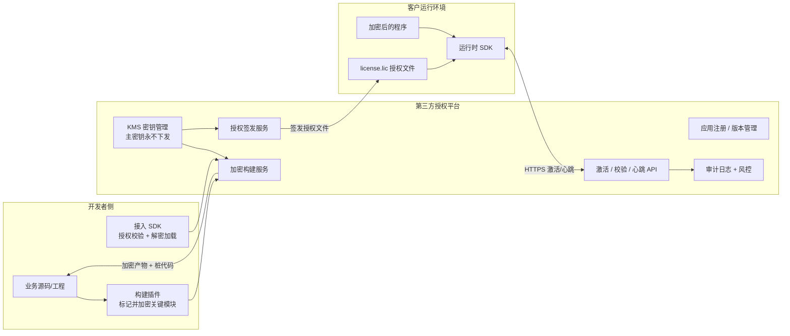
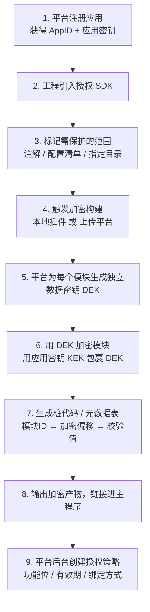
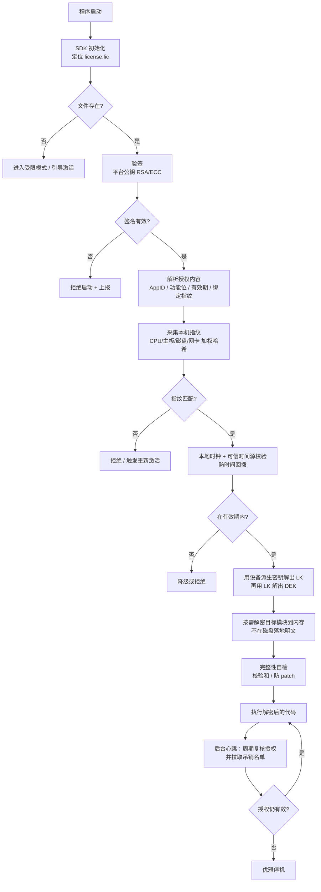
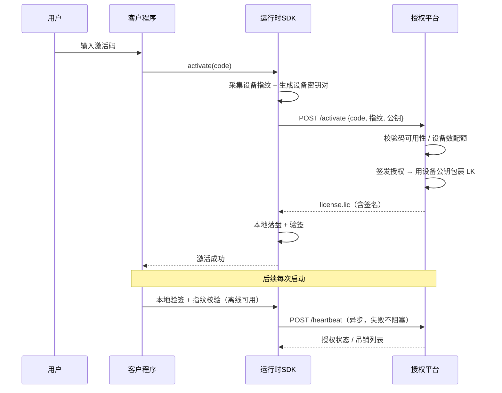
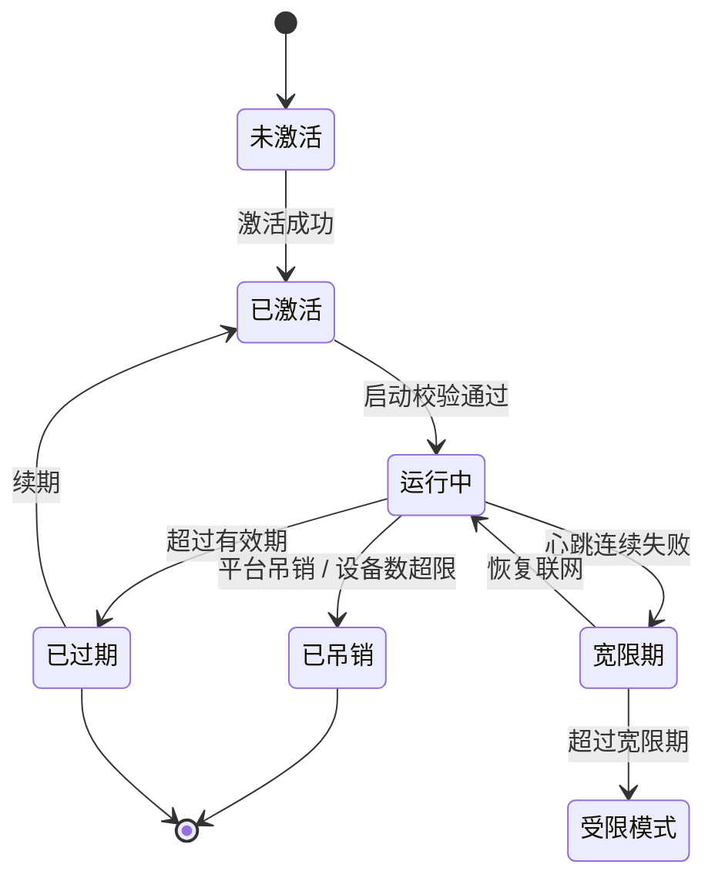

# 你的想法梳理

先对齐两个概念，你的描述里有两处需要修正：

1. **"读取授权文件完成加密后使用"** → 实际是 **解密**。构建期加密，运行期解密到内存执行。
2. **"关键代码加密"** 的落地方式强依赖语言：托管语言（Java/.NET/Node/Python）加密的是字节码/程序集；原生语言（C/C++/Go/Rust）加密的是二进制段，需要内存加载器。这决定了整个架构。

核心矛盾提前说清楚：**只要解密发生在客户机器上，密钥就必须在客户机器上（或能推导出来），所以理论上一定能被逆向提取**。这类平台的目标是 **把破解成本抬到高于软件本身价值**，不是"绝对不可破"。真正不可破的只有"关键逻辑放服务端"。

---

## 一、总体架构

---

## 二、开发期：接入与加密构建流程

**关键设计：密钥分层，避免"破一个全盘皆输"**

| 层级 | 位置 | 作用 |
|---|---|---|
| 主密钥 MK | 平台 KMS（HSM） | 永不离开平台 |
| 应用密钥 KEK | 构建时注入，加密包裹 | 一应用一密钥 |
| 授权密钥 LK | 随 license 下发，被设备指纹派生密钥包裹 | 一授权一密钥 |
| 数据密钥 DEK | 内嵌于加密产物（被 KEK 包裹） | 一模块一密钥 |
| 会话密钥 SK | 运行时随机生成 | 仅内存中解密用 |

---

## 三、运行期：启动 → 授权 → 解密 → 执行

---

## 四、激活时序（首次 + 日常）

---

## 五、授权生命周期状态机

---

## 六、几个必须提前决策的点

| 决策点 | 选项 | 建议 |
|---|---|---|
| 在线 vs 离线 | 纯在线 / 纯离线 / 混合 | **混合**：本地验签保证离线可用，心跳做吊销 |
| 解密粒度 | 启动时全解 / 按需解 / 逐函数解 | 按需解，降低内存明文窗口 |
| 防调试 | 反调试 / 反注入 / 反 dump | 适度，过度会误伤正常用户和杀软 |
| 时间校验 | 仅本地时钟 / 联网 / 上次运行时间戳 | 三者结合，单独用本地时钟必被回拨 |
| 指纹强度 | 单硬件 / 多硬件加权 / 容错阈值 | 加权 + 允许 1~2 项变化，避免换硬盘就失效 |
| 关键逻辑 | 本地 / 上云 | **最核心的放服务端**，这是唯一真正的护城河 |

---

## 七、你的方案的固有风险（要提前想好）

1. **内存明文窗口**：模块解密到内存后必然可 dump。对策：白盒密码、分片解密、用后即擦、关键函数用虚拟机保护。
2. **Hook 解密函数**：攻击者不破解算法，直接 hook `decrypt()` 拿明文。对策：控制流平坦化、内联、多点校验。
3. **Patch 校验分支**：`if (!valid) exit()` 一个字节就能跳过。对策：校验结果参与后续计算（让跳过导致崩溃而非放行），而不是单纯的分支。
4. **license 文件复制**：靠指纹绑定 + 服务端设备数限制。
5. **SDK 自身被替换**：需要主程序侧对 SDK 做完整性校验。

---

## 八、建议的 MVP 范围

第一版别碰虚拟机保护和壳，按这个顺序做：

1. license 文件格式 + 非对称签名验签（**这是地基**）
2. 设备指纹采集 + 加权匹配
3. 关键模块加密 + 运行时内存加载（先支持一种语言）
4. 在线激活 + 设备数配额
5. 心跳 + 吊销列表
6. 之后再叠加：白盒密钥、反调试、完整性自检、虚拟机保护

---

想继续深入的话，告诉我你的**技术栈**（Java / .NET / Node / Python / C++ / Go）和**部署形态**（桌面端 / 私有化服务器 / 容器），我可以把"关键模块加密 + 运行时加载"这一段细化成具体的方案和代码骨架——这块不同语言差别非常大。