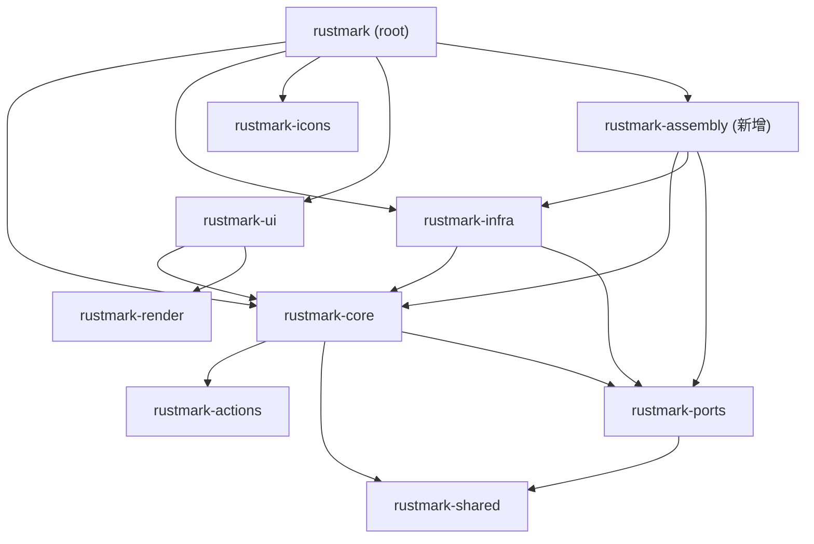

# R-10 项 B 补全：M2「独立装配 crate」详细落地方案

> 作者：顾图南（架构师）· 2026-10-29 · 依据：原始 assignment（M2 设计）+ 对 6 条待复核事实的**读码实测复核**。
> 性质：纯架构设计文档，**未改动 `crates/` 与 `src/` 下任何源码**（唯一产出即本文件；实施者是后续 PR）。
> 配套文档：`docs/remediation/r10/max-solution.md`（最大解评估，已判定 M2 为 YAGNI）、`docs/remediation/r10/evaluation.md`。
>
> **状态与前置结论**：M2 的「平移 vs 收敛」独立复核已完成，设计已就绪；但**触发条件未被满足**（事实⑤经实测证伪，见 §「我推翻主理人判断的地方」）。本方案定位为**「触发即执行」的货架方案**——结构、改动面、门禁联动都已钉死，但**当前不建议落地**，理由见同节。

---

## 0. 现状装配面画像（读码实测）+ 6 条事实复核结论

### 0.1 装配面现状（实测 `src/app/bootstrap.rs`，347 行）

- **装配正主**：`production_bundle(&ConfigPaths) -> ImplBundle`（`bootstrap.rs:192-208`）——**全仓唯一点名 13 个具体 impl 的地方**，13 个 `crate::infrastructure::…` import 集中在 `L30-42`（除 `SystemClock` 经 `rustmark_core::ports::time` 取，见 `L54`）。
- **服务聚合**：`pub struct Services`（`bootstrap.rs:144-185`）——**实测 14 个 `pub` 字段**：`documents / markdown / export / preferences / workspace / dialogs / opener / images / registry / render_cache / assets / workspace_id / auto_save_tracker / drafts_dir`。
- **配置路径**：`pub struct ConfigPaths`（`bootstrap.rs:63-135`），含 `detect()`（按平台推导，`L83-99`）、`in_dir()`（`L102-108`）、`drafts_dir()`（`L114-120`）、`crash_dir()`（`L128-134`）。
- **测试入口**：5 个公开 `assemble_with_*`（`assemble` `L223` / `assemble_with_dialogs` `L236` / `assemble_with_clock_and_dialogs` `L256` / `assemble_with_opener` `L271` / `assemble_with_image_store` `L289`）；私有终点 `assemble_with_bundle`（`L308-345`，穷尽解构 `AppServices` → `Services`）。
- **core 侧 DI 边界**（`crates/rustmark-core/src/application/composition.rs`，253 行）：`ImplBundle`（13 字段 `L67-95`）、`ComposeConfig`（含 `drafts_dir` `L101-112`）、`AppServices`（**实测 13 字段** `L117-144`）、`compose()`（`L150-252`）。core 模块文档 `L14-20` 明写"绝不 `use rustmark_infra`"——core→infra 红线被钉死。
- **`Services`(14) 比 `AppServices`(13) 恰多 `assets`**：`AssetLoader`（UI 侧图片解码，`bootstrap.rs:178,340` 注入），消费点唯一 `src/app/frame/view_context.rs:636`。

### 0.2 六条事实的逐条复核结论

| # | 主理人陈述 | 实测结论 | 证据 |
|---|---|---|---|
| ① | 装配面可做到完全 egui-free（infra/core 的 `cargo tree -e normal` 对 egui\|eframe\|wgpu 命中 0） | **成立**。infra、core、ports 三者 `cargo tree -p … -e normal` 对 `egui\|eframe\|wgpu` 命中均为 **0** | 实测命令输出；assembly 若依赖 {core, infra, ports} 则无 egui 传导路径 |
| ② | root 的 infra 引用 = bootstrap 13 处 + frame 15 处 | **结论成立，数字需微调**：bootstrap 13 处 impl 点名（`bootstrap.rs:30-42`）；frame 侧**运行时**引用实为 **14 处**（capture.rs 9 / frame.rs 2 / loop.rs 1 / state.rs 1 / app.rs 1；其中 capture.rs 2 处为 `///` doc 注释，非运行时） | `grep -rn 'crate::infrastructure::' src/` 共 **27 处**（13+14）；主理人"15"略有出入 |
| ③ | `Services` 15 字段 / `AppServices` 14 字段，全部 egui-free | **结论成立，字段数需更正**：`Services` **14**、`AppServices` **13**、`ImplBundle` **13**（差集恰为 `assets`） | Python 精确解析 `bootstrap.rs` + `composition.rs` 字段清单 |
| ④ | `AssetLoader` egui 命中 0，仅 1 处消费 | **成立**。`AssetLoader`（`crates/rustmark-infra/src/infrastructure/persistence/asset_loader.rs`）egui 命中 0；唯一消费 `src/app/frame/view_context.rs:636` | `grep -rn 'AssetLoader' src/` |
| ⑤ | `tests/` 里 20+ 个无 GUI 测试是现成第二消费者，M2 后可直连新 crate 不拉 root | **不成立（关键反证，见 §推翻）**。包内 integration test **结构性**链接 root lib + eframe + egui；58 个用 `rustmark::app::bootstrap` 的测试文件**无一例外**同时使用其它 `rustmark::` 路径 | `cargo build --test shared -v` 显示必收 `--extern rustmark=…`、`--extern eframe=…`、`--extern egui=…`（即便该测试 `rustmark::` 命中为 0） |
| ⑥ | 现有 12 条本地依赖边无环 | **成立**。实测 `cargo tree --workspace --depth 1 --no-dedupe` 归一化后本地边 = **12 条**，无环 | `docs/spec/workspace-topology.expected.txt` 机器主体（L85-89 列出 12 条） |

> 事实②/③的偏差属计数口径，不影响架构判定；**事实⑤的偏差是方向性的**——它直接决定 M2 是否该做（见 §推翻）。

---

## 1. crate 边界与命名

### 1.1 命名与位置
- 名称：**`rustmark-assembly`**（主理人倾向，采纳）。
- 路径：**`crates/rustmark-assembly/`**，结构 `crates/rustmark-assembly/src/{lib.rs, bootstrap.rs}`。
- 不新增二进制、不新增测试目标（`autotests` 可默认开启，因该 crate 无 `tests/`）。

### 1.2 依赖面（恰为 3 个本地 crate）

```toml
# crates/rustmark-assembly/Cargo.toml（草稿）
[package]
name  = "rustmark-assembly"
version = "0.2.0"
edition = "2024"
rust-version = "1.99"
publish = false

[dependencies]
rustmark-core  = { path = "../rustmark-core" }  # 六边形脊柱：compose / ImplBundle / AppServices / ComposeConfig
rustmark-infra = { path = "../rustmark-infra" } # 13 个 impl 类型住此（RfdDialogAdapter 等）
rustmark-ports = { path = "../rustmark-ports" } # SystemClock 实现住此（time.rs）；与 infra 同范式直连取端口契约
# 说明：anyhow 无需直接依赖——AppResult 即 anyhow::Result，经 core 传递；`?` 在
#       assembly 内对 AppResult 工作无需本 crate 引入 anyhow。
```

**`rustmark-ports` 必须直接依赖**（而非仅经 `rustmark_core::ports` 间接取），理由三选其一皆成立：
1. `production_bundle` 直接构造 `SystemClock`，其实现住在 `rustmark-ports`（`crates/rustmark-ports/src/time.rs:68`）；要 `rustmark_ports::time::SystemClock` 必须直连。
2. 与 **infra 既有先例一致**——infra 已直连 ports 取端口契约（`crates/rustmark-infra/Cargo.toml` 注释 `L11-16`："infra 直接依赖本 crate 取端口契约…不再经 `rustmark_core::shared::<port>` 间接取"）。
3. 依赖面断言 `{core, infra, ports}` 显式可读，避免"ports 边被 `rustmark_core::ports` 间接藏起"导致的隐性耦合。

### 1.3 egui-free 论证

assembly 的 normal 依赖树 = core ∪ infra ∪ ports 的 normal 树。事实①已证这三者对 `egui|eframe|wgpu` 命中均为 0，故 **assembly 构造上 egui-free**。这与"装配逻辑本就不该碰 GUI 原语"一致——`AssetLoader` 虽经 infra 引入，但 infra 自身 egui 命中 0（事实④），assembly 仅持有其类型、不触发任何 GUI 后端。

### 1.4 依赖方向图（M2 后，12 → 16 条本地边）



> 注意：**M2 不缩减 root 依赖面（root 仍需 core + infra + icons + ui），只新增 root→assembly 一条边 + assembly 的 3 条出边 = 净增 4 条边**（12 → 16）。root 不能丢 infra——frame 侧 14 处 `crate::infrastructure::` 运行时调用与 `src/lib.rs:57` 的 re-export 仍依赖它（见 §3）。

---

## 2. 搬 / 不搬裁决表

| 裁决 | 项 | 现状位置 | 理由 |
|---|---|---|---|
| ✅ 搬 | `production_bundle()` | `bootstrap.rs:192` | M2 正主——13 个 impl 点名；搬走后 root **零** impl 点名 |
| ✅ 搬 | `pub struct Services`（14 字段） | `bootstrap.rs:144` | 装配聚合产物；搬后 `frame/` 的 71 处 `services.<field>` **零改动**（字段访问不依赖类型定义位置，见 §2.1） |
| ✅ 搬 | `pub struct ConfigPaths`（`detect`/`in_dir`/`drafts_dir`/`crash_dir`） | `bootstrap.rs:63` | 被 root 与 `tests/` 大量引用；搬后由 root `pub use` 稳定路径 |
| ✅ 搬 | 5 个 `assemble_with_*`（公开测试入口） | `bootstrap.rs:223-302` | 被 `tests/app/*` 12+ 文件直接调用；公开路径须保留 |
| ✅ 搬 | 私有 `assemble_with_bundle` + 穷尽解构 | `bootstrap.rs:308` | 随 `Services` 一并搬入新 crate |
| ❌ 不搬 | `PREVIEW_DEBOUNCE_MS`（`bootstrap.rs:61`） | root `bootstrap.rs` | 测试便利常量（re-export 共享内核常量）；留 root 可保持 `thresholds.baseline.yaml` 的 `source: "src/app/bootstrap.rs:NN"` 路径基本不变（仅行号漂移，见 §4） |
| ❌ 不搬 | root `frame/` 运行时 `crate::infrastructure::` 调用（14 处） | `frame/capture.rs`(9) / `frame.rs`(2) / `loop.rs` / `state.rs` / `app.rs` | 截图/字体等 GUI 侧资源持有；属 root 组合根本职，非装配逻辑 |
| ❌ 不搬 | root 对 `rustmark_core::` 的 123 处引用 | `frame.rs` 等 | root 必须保留 `rustmark-core` 直接依赖 |
| ❌ 不搬 | `src/lib.rs:57` `pub use rustmark_infra::infrastructure;` | root `lib.rs` | root 仍需 infra 命名空间给 frame 用 |

### 2.1 关键裁决：`pub use` re-export 保路径不变 vs 改 import 路径

**裁决：采用 `pub use` re-export，保持 `rustmark::app::bootstrap::*` 公开路径完全不变。**

- root 改造后 `src/app/bootstrap.rs` 成为薄门面：
  ```rust
  //! 组合根装配公开门面（M2：实现已下沉 `rustmark-assembly`）。
  //! 经 re-export 拼回 `rustmark::app::bootstrap::*` 原路径，消费方零改动。
  pub use rustmark_assembly::bootstrap::*;
  // 测试便利常量（与装配无关）留 root，避免动 thresholds 基线 source 路径：
  pub const PREVIEW_DEBOUNCE_MS: u64 = rustmark_core::shared::constants::DEBOUNCE_MS;
  ```
- 由此：`src/app.rs:9` `pub mod bootstrap;` 与 `:14` `use bootstrap::{ConfigPaths, Services};` 不变；`tests/` 中 **58 个** `use rustmark::app::bootstrap::…` 不变；`frame/` 中 **71 处** `self.services.<field>` 不变（类型来自 core/infra/ports，root 仍直接依赖，字段访问与类型定义位置解耦）。
- **为何不选"改 import 路径让消费方直连 `rustmark_assembly`"**：那要改 58 个测试文件 + frame 引用，改动面大且收益为零（路径本就是公开 API，re-export 无信息损失）。re-export 是"零改动"的凭空省下的成本。

---

## 3. root 侧处置

### 3.1 `src/app/bootstrap.rs` 改造后形态
薄 re-export shim（见 §2.1 草稿）——**仅 2 行实质内容**（`pub use …::*` + 保留 `PREVIEW_DEBOUNCE_MS` const）。impl 点名、服务聚合、测试入口全部移至 `crates/rustmark-assembly/src/bootstrap.rs`。

### 3.2 root `Cargo.toml` 依赖面变化
- **新增**：`rustmark-assembly = { path = "crates/rustmark-assembly" }`（置于 `[dependencies]` 本地 crate 区）。
- **保留**：`rustmark-core` / `rustmark-infra` / `rustmark-icons` / `rustmark-ui`（root 仍需这四者）。
- **`[workspace] members` / `default-members`**：各加 `"crates/rustmark-assembly"`；`default-members` 中的 `"."` **必须保留**（门禁兜底，见 §5）。

### 3.3 完整依赖边清单（16 条，无环）

```
root → {core, infra, icons, ui, assembly}          (5 条)
assembly → {core, infra, ports}                    (3 条，新增)
core → {actions, shared, ports}                    (3 条)
infra → {core, ports}                              (2 条)
ui → {core, render}                                (2 条)
ports → shared                                     (1 条)
────────────────────────────
合计 16 条，无环（assembly 不反向依赖 root；core→infra 红线仍由 topology 断言钉死）
```

### 3.4 `src/lib.rs:57` 保留论证
`pub use rustmark_infra::infrastructure;` 是 root 组合根合法装配路径（R-01 注释 `L42-48` 明说不在禁列）。frame 侧 14 处 `crate::infrastructure::` 运行时调用依赖它；M2 不搬这些调用，故该 re-export **必须保留**，root→infra 边仍存在。

---

## 4. 守卫与基线同步清单（逐文件、逐行号 + 可粘贴草稿）

> 核心原则（呼应 `arch_check.rs` 文档 `L2114-2118`）：**新增 crate 时只改 `src_roots` 一处**。其余守卫靠"复用既有 `Layer` 变体 + `forced_layer` 短路"零改动覆盖。

### 4.1 `tools/arch_check.rs` —— 只加一行 `src_roots`

**位置**：`src_roots()`（`arch_check.rs:1377-1421`），在 ports 行（`:1415-1419`）之后追加：

```rust
        (
            manifest.join("crates").join("rustmark-assembly").join("src"),
            "crates/rustmark-assembly/src/",
            Some(Layer::App),   // 复用组合根层：bootstrap.rs 当前就判 Layer::App（无层禁令）
        ),
```

**为何不新增 `Layer::Assembly` 变体**：
- `Layer::App`（枚举 `arch_check.rs:301-302`）语义即"组合根：允许依赖全部层"，assembly 是组合根下沉，**语义精确对应**。
- `forbidden_for(Layer::App)` 落在 `:472` 的 `Layer::App | Layer::Free | Layer::Ports | Layer::Unknown => Vec::new()` 分支——**无层禁令**，与 bootstrap.rs 当前层判定（root `src/app/` → `Layer::App`）**逐字一致**，即"零改动保持现状"。
- `scan_project`（`L2165`）逻辑：`let layer = forced_layer.unwrap_or_else(|| layer_of(&rel));`——`forced_layer = Some(App)` **短路**，assembly 文件根本不进 `layer_of`，故**不会**因 `bootstrap.rs` 首段非既有层名而误报 `Layer::Unknown`（`L2428` 的 Unknown 误报分支被彻底绕过）。这与 ports 用 `Some(Layer::Ports)` 的先例一致。
- 故：**不碰** `Layer` 枚举、`layer_of`（`L391`）、`forbidden_for`（`L427`）、`allowed_for`（`L509`）、`label`（`L341`）。新增变体反而要在 4 处 match 补全、且"漏改即漏报"（校验器教条：漏报比多报危险）。

**联动确认**：`check_rich_egui_isolation_with`（`L1471`）复用同一份 `src_roots`；assembly 根不以 `rustmark-render/src` 结尾、无 `presentation/rich` 子目录 → 直接 `continue`（`L1486-1488`），不会误报 egui。一行动态同时覆盖 `scan_project` 与 rich-egui 两处扫描器。

### 4.2 `tests/workspace_topology_test.rs` —— 仿 `infra_crate_depends_on_core_only` 加断言

注意：拓扑断言须**与 §4.3 的 `expected.txt` 重生成同步落库**，否则 CI 第八步（`ci.yml` 拓扑 diff）必红。新增测试（贴在 `L446` 之后）：

```rust
/// `rustmark-assembly` 的 workspace 依赖面必须恰为 **rustmark-core + rustmark-infra +
/// rustmark-ports**（M2，2026-10-29）。
///
/// 它是组合根下沉：点名 13 个 infra impl（含 `SystemClock` 住在 ports），故必须能看见
/// core（compose / ImplBundle / AppServices）+ infra（impl 类型）+ ports（SystemClock）。
/// 多一条即层级倒置或成环，少一条则 impl 不可见。
#[test]
fn assembly_crate_depends_on_core_infra_ports() {
    let path = std::path::PathBuf::from(env!("CARGO_MANIFEST_DIR"))
        .join("crates")
        .join("rustmark-assembly")
        .join("Cargo.toml");
    let text = std::fs::read_to_string(&path).expect("assembly crate 的 Cargo.toml 应可读");

    let mut workspace_deps = BTreeSet::new();
    let mut section = String::new();
    for raw in text.lines() {
        let line = raw.trim();
        if line.is_empty() || line.starts_with('#') {
            continue;
        }
        if line.starts_with('[') {
            section = line.to_string();
            continue;
        }
        // normal / dev / build / target-specific 一律算（与 infra 断言同口径）。
        if !section.contains("dependencies") {
            continue;
        }
        if let Some((name, _)) = line.split_once('=') {
            let name = name.trim();
            if name.starts_with("rustmark") {
                workspace_deps.insert(name.to_string());
            }
        }
    }

    let expected: BTreeSet<String> =
        ["rustmark-core", "rustmark-infra", "rustmark-ports"]
            .iter()
            .map(|s| s.to_string())
            .collect();
    assert_eq!(
        workspace_deps, expected,
        "rustmark-assembly 的 workspace 依赖面必须恰为 rustmark-core + rustmark-infra + \
         rustmark-ports（M2）；多一条即层级倒置或成环，少一条则 impl 不可见"
    );
}
```

> `default_members_cover_every_workspace_member`（`L69-94`）随 `members` 列表自动校验 assembly 已登记，无需改。

### 4.3 `docs/spec/workspace-topology.expected.txt` —— 重生成（第八条门禁）

改 `Cargo.toml` / `Cargo.lock` 后**必须**重生成（CI 第八步对 `cargo tree … | grep -v '^#'` 与期望文件 diff；`gen_dep_graph.sh` 保留注释头只重写机器主体）：

```bash
export RUSTUP_HOME=/d/Dev/Rust/.rustup CARGO_HOME=/d/Dev/Rust/.cargo PATH=/d/Dev/Rust/.cargo/bin:$PATH
bash scripts/gen_dep_graph.sh
git add docs/spec/workspace-topology.expected.txt
```

重生成后机器主体末端会多出 `rustmark-assembly` 块（依赖 core/infra/ports），本地边由 **12 → 16**。另在文件注释头追加一条基线更新段（仿 `L78-89` 格式），记录"2026-10-29 M2 抽 `rustmark-assembly`：12 → 16 条"。

### 4.4 `docs/spec/architecture-constraints.md`

- **§10.1 crate 地图**（`L677-704`）：crate 表加一行 `rustmark-assembly`（角色：组合根下沉 / 装配门面；依赖面 core+infra+ports）；边计数 `12 条` → `16 条`（两处 `L679`、`L691`）。
- **§4.5 共享准入登记表**（`L303+`）：assembly **不进 `shared/`**，无需登记；此处**不改**。

### 4.5 `docs/spec/thresholds.baseline.yaml` —— `preview_debounce_ms` 行号漂移

条目 `preview_debounce_ms`（`L570-578`）：`source: "src/app/bootstrap.rs:61"`、`anchor: "PREVIEW_DEBOUNCE_MS: u64 = rustmark_core::shared::constants::DEBOUNCE_MS"`、`via: "…/constants.rs"`。

- 因 `PREVIEW_DEBOUNCE_MS` **留 root**（§2 裁决），`source` 路径不变，仅行号随文件瘦身而**漂移**。
- `check_thresholds.py`（`check()` `L192-211`）对锚点漂移仅 **WARN**（`drifts`），CI（Linux-only，非 strict）不失败；提交前跑一次 `--fix` 回写行号即可：
  ```bash
  python tools/check_thresholds.py --fix
  ```
- **可选增强**：若选择把 `PREVIEW_DEBOUNCE_MS` 也搬进 assembly，则需把 `source` 改为 `crates/rustmark-assembly/src/bootstrap.rs:NN`、`anchor` 不变、`via` 不变，`--fix` 更新行号。本方案选"留 root"以最小化基线扰动。

### 4.6 文档写死的「9-crate / 12 边」口径——联动更新清单

| 文件 | 位置 | 改前 → 改后 |
|---|---|---|
| `docs/spec/current_dependency_graph.html` | `L3` / `L26` / `L92` | `9 个 crate、12 条本地依赖边` → `10 个 crate、16 条本地依赖边`；`<!-- 边（12 条）-->` → `16`；并补 assembly 节点 + 4 条边 |
| `docs/README.md` | `L50-51` | `12 条本地依赖边` → `16 条`；`9 crate / 12 条` → `10 crate / 16 条` |
| `docs/plans/PROGRESS.md` | `L90` / `L94` | `workspace 现为 9 crate` → `10 crate`；`本地依赖边 12 条` → `16 条` |

> 注：`workspace-topology.expected.txt` 注释头末条仍写「8 → 9 条」（R-04 旧值，机器主体已是 12 条）——本步一并更正为「12 → 16 条」，消除文档自相矛盾。

### 4.7 其余守卫——确认无需改动

| 守卫 | 文件 / 行 | 结论 |
|---|---|---|
| `field_visibility_guard` | `tests/field_visibility_guard_test.rs:869-886`（`roots: [(&str, PathBuf); 7]`） | **不改**。该 `roots` 数组**不含 root**（故 `Services` 当前 14 个 pub 字段本就未被覆盖）；assembly 不加入 = 与现状**对等**，零回归。若追求 parity 覆盖可后续加 assembly 到 roots + 白名单，但非 M2 必需 |
| `internal_cycle_guard` | `tests/shared/internal_cycle_guard_test.rs` | **不改**。射程仅 `crates/rustmark-shared/src/shared`，assembly 不在其内 |
| `ROOT_FEDERATED_LAYERS` | `arch_check.rs:2571`（`["domain","shared","application"]`） | **不改**。仅对 root 空前缀生效（`scan_project` `L2196`）；assembly 前缀非空，跳过 |
| `test_target_guard` | `tests/test_target_guard_test.rs` | **不改**。assembly 无 `tests/`、无 `[[test]]`；`autotests` 默认不影响 |

---

## 5. 风险与回归地雷

| 风险 | 评估 | 处置 |
|---|---|---|
| **体积门禁** | 当前基线 ~10,589,696 B（≈10.10 MiB，`docs/spec/metrics.md` L12）；预警线 10.5 MiB = 11,010,048 B、红线 11 MiB = 11,534,336 B，余量 ~410 KB。历史拆 crate 增量：shared +2,048 / infra +3,072 / render +5,120 / ports −512 B | 新增 crate 预计 +2~5 KB（LTO 边界 + 符号脚手架），**不触预警线**。若极端超线：收紧某 crate 的 `opt-level`/移除未用 extern 兜底，或推迟 M2 |
| **`tests/` 改动面** | 58 个 `rustmark::app::bootstrap` 消费文件"看似大动" | **实际零改动**（re-export 路径不变）。须**实证**：`git diff --stat -- tests/ src/app/frame/ src/app.rs` 为空 + `cargo test --workspace --all-targets` 全绿 |
| **`check-arch` 对新 crate `Layer::Unknown` 误报** | 新 crate 首段非既有层名，若无 `forced_layer` 必误报 | 已通过 `src_roots` 加 `Some(Layer::App)`（§4.1）**彻底短路** `layer_of`，误报分支（`L2428`）永不触发 |
| **`default-members` 兜底** | 不带 `--workspace` 的裸命令须仍覆盖全部成员 | `"."` 保留（`Cargo.toml:31`）；assembly 加入 `default-members`（`L30-40`） |
| **静默成环** | assembly 若误依赖 root → 与 root→assembly 成环 | root 不依赖 assembly 的公开 API 反向；且 topology 断言（`assembly_crate_depends_on_core_infra_ports` + `expected.txt`）钉死 assembly 只依赖 {core,infra,ports}，成环即红 |
| **re-export 路径写错致 tests 编译失败** | `pub use rustmark_assembly::bootstrap::*` 路径/模块名错 → 58 文件全红 | 由 `cargo test --workspace --all-targets` 全绿 + `cargo run --bin check-arch` 绿**双重验证** |
| **阈值基线 `PREVIEW_DEBOUNCE_MS` 行漂移** | 留 root 后行号变 | `python tools/check_thresholds.py --fix` 回写（§4.5） |

---

## 6. 最小可行落地路径（可独立验证的增量步骤）

> 每步**编译通过 + 门禁可跑**；改动面隔离，任一步可单独回滚。

**Step 0｜前置**：确认 `git status` 干净、`HEAD = 628b535`。
```bash
export RUSTUP_HOME=/d/Dev/Rust/.rustup CARGO_HOME=/d/Dev/Rust/.cargo PATH=/d/Dev/Rust/.cargo/bin:$PATH
git status --short
```

**Step 1｜建 crate 骨架 + 登记 + 守卫扫描根**
- 新建 `crates/rustmark-assembly/Cargo.toml`（§1.2 草稿）、`src/lib.rs`（`pub mod bootstrap;`）、`src/bootstrap.rs`（先空壳 `pub struct Placeholder;` 占位）。
- root `Cargo.toml`：`members` + `default-members` 加 `"crates/rustmark-assembly"`；`[dependencies]` 加 `rustmark-assembly`。
- `tools/arch_check.rs`：`src_roots` 加 §4.1 一行。
- 验证：`cargo check --workspace` 通过；`cargo run --bin check-arch` 绿。

**Step 2｜搬装配实现**
- 将 `bootstrap.rs:30-42,54,61` 之外的 impl 点名 / `Services` / `ConfigPaths` / 5 个 `assemble_with_*` / `assemble_with_bundle` 整体复制到 `crates/rustmark-assembly/src/bootstrap.rs`（`use` 改为 `rustmark_core::…` / `rustmark_infra::…` / `rustmark_ports::…`）。
- 验证：`cargo check -p rustmark-assembly` 通过。

**Step 3｜root 改薄门面**
- `src/app/bootstrap.rs` 改为 §2.1 的 re-export shim（保留 `PREVIEW_DEBOUNCE_MS`）。
- 验证：`cargo check --workspace` + `cargo test --workspace --all-targets`（重点 `tests/app/*`、`tests/integration/alignment_test.rs`、`tests/app/bootstrap_test.rs`）。

**Step 4｜拓扑与文档联动**
- `bash scripts/gen_dep_graph.sh` 重生成 `expected.txt`；加 `assembly_crate_depends_on_core_infra_ports` 测试（§4.2）。
- 更新 §10.1 / §4.5 不适用 / 4.6 三处文档口径（9→10 crate、12→16 边）。
- `python tools/check_thresholds.py --fix` 回写行号。
- 验证：`cargo test --test workspace_topology` 绿；`cargo run --bin check-arch` 绿；`python tools/check_thresholds.py` 绿。

**Step 5｜全套门禁（对齐 `ci.yml` 八步）**
```bash
cargo fmt --check
cargo clippy --workspace --all-targets -- -D warnings
cargo check --workspace --all-targets
cargo run --bin check-arch
python tools/check_thresholds.py --fix
cargo test --workspace --all-targets --no-fail-fast
cargo test --workspace --doc
cargo build --release && bash scripts/size_gate.sh
```

**「tests/ 与 frame/ 零改动」的机械化验证（非声称）**：
```bash
git diff --stat -- tests/ src/app/frame/ src/app.rs   # 必须为空
cargo test --workspace --all-targets 2>&1 | tail -3   # 全绿（含 58 个 bootstrap 消费用例）
cargo run --bin check-arch 2>&1 | tail -1             # 无违规
```
三者同时满足 = "零改动"被**证明**，而非声明。

---

## 我推翻主理人判断的地方

### ① 事实⑤「tests/ 是现成第二消费者」经实测证伪 → M2 触发条件未满足

主理人依据事实⑤认为"M2 的触发条件（max-solution.md §5：第二消费者出现）已满足"。独立复核结论相反，证据链：

1. **结构性链接**：`cargo build --test shared -v` 显示，即便该测试 `rustmark::` 命中为 0，rustc 仍收到 `--extern rustmark=…librustmark`、`--extern eframe=…`、`--extern egui=…`。包内 integration test **必然**链接 root lib 及其 eframe/wgpu 依赖树——"不拉 root"在包内 `tests/` 语境下**结构上不可达**（除非把测试搬进独立 crate，那本身就是"新建第二消费者"，而非"复用现有消费者"）。对 `tests/field_visibility_guard` 重复验证，结论一致。
2. **路径不可分离**：`grep -rl 'app::bootstrap' tests/` = **58 个文件**，逐文件提取 `rustmark::` 路径后，**无一例外**同时使用其它层路径（`app::frame` / `presentation::*` / `application::*` / `domain::*` / `shared::*` / `ports::*` / `infrastructure::*`）。仅 `tests/app/bootstrap_test.rs` 与 `tests/integration/alignment_test.rs` 两文件的 bootstrap 用途在语义上可分离，但它们仍走 root 测试目标、仍链 root lib。
3. **结论**：当前**不存在任何**"不拉 root 就能复用装配"的第二消费者。M2 的真实收益（"装配可独立调用，未来第二消费者免复制"）是**未发生、仅预期的**，而非"已兑现"。

### ② 事实②数值更正（15 → 14）；事实③字段数更正（15/14 → 14/13）

- 框架侧 `crate::infrastructure::` 运行时引用实测 **14 处**（非 15）：capture.rs 9、frame.rs 2、loop.rs 1、state.rs 1、app.rs 1（capture.rs 另有 2 处 `///` doc 注释非运行时）。
- `Services` **14** 字段 / `AppServices` **13** / `ImplBundle` **13**（差集恰为 `assets`），非任务书所写 15/14。

### ③ 综合裁决：M2 仍是「平移」而非「收敛」，建议保持 YAGNI（货架方案）

- 与 `max-solution.md` §2 判定一致：M2 把 13 个 impl 点名从 root 的 `bootstrap.rs` **平移**到 assembly 的 `bootstrap.rs`，root 依赖面**不缩反增**（12 → 16 边），无结构收益；唯一真实收益是"未来第二消费者可复用装配而不拉 root"——而该消费者**当前不存在**（事实⑤证伪）。
- **本方案定位**：非"立即执行计划"，而是**「触发即执行」的货架方案**——一旦真出现无头 CLI / wasm / 独立测试 harness（作为独立 crate）需要复用装配而不拉 root，本设计可零额外设计直接落地。
- **我的明确建议**：**当前不要做 M2**。把它留在货架上，本文件即其完整设计依据。若团队出于"提前收敛装配面"的治理偏好坚持现在做，落地路径见 §6，且门禁全绿可保证零回归——但请知悉这仍是预付复杂度、收益待兑现。

---

**一句话**：M2 设计已就绪（crate 边界、`src_roots` 一处改动、re-export 零改动消费方、16 边无环、全套门禁联动都钉死），但触发条件"第二消费者出现"经实测**未满足**，故它仍是 max-solution.md 判定的 YAGNI 平移——本文件是货架方案，不是今日待执行的工单。
